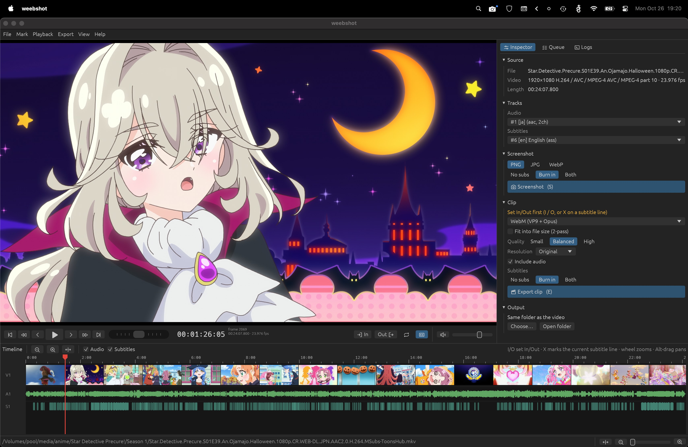

# Weebshot


A screenshot and clip tool for anime. Open an episode, find the frame or line you want, and save a
full-resolution screenshot or cut a WebM, MP4, MKV, GIF or animated WebP, with subtitles burned in,
left out, or both.

[](https://github.com/Melanpan/weebshot/releases/latest)
[](https://github.com/Melanpan/weebshot/actions/workflows/ci.yml)
[](LICENSE)


> [!WARNING]
> **This project was vibecoded** — written largely by an AI coding assistant, with a human steering
> and testing. It works and has a decent test suite, but it hasn't had the scrutiny of a carefully
> hand-written project. Expect rough edges, and please report what you find. (Weebshot only ever
> *creates* new files; it never modifies your videos.)


## What it makes

The scene above, marked with one key press on its subtitle line and exported twice:


| | Settings | Size |
| --- | --- | --- |
| [**WebM**](docs/examples/gekota-kick.webm) (click to play) | 1080p, VP9 + Opus, subtitles burned in, *fit into 8 MB* | 3.7 MB · 6.1 s |
| **GIF** (above) | 360p, 15 fps, Balanced preset, duplicate frames dropped | 2.6 MB · 6.1 s |

## Download

| Platform | Download | |
| --- | --- | --- |
| **Windows** 10/11 (x64) | [`weebshot-windows-x64.zip`](https://github.com/Melanpan/weebshot/releases/latest/download/weebshot-windows-x64.zip) | unzip and run `weebshot.exe` |
| **Linux** (x86-64) | [`weebshot-x86_64.AppImage`](https://github.com/Melanpan/weebshot/releases/latest/download/weebshot-x86_64.AppImage) | make executable and run |
| **macOS** (Apple Silicon) | [`weebshot-macos-arm64.zip`](https://github.com/Melanpan/weebshot/releases/latest/download/weebshot-macos-arm64.zip) | right-click → Open the first time · *experimental* |

Everything is included (player, ffmpeg, gifsicle) — no separate installs. Weebshot checks for
updates once a day and can update itself on Windows and Linux.
More in [Installing & updating](docs/install.md).

## Features

### Finding a frame
- Arrow keys step one frame at a time (Shift/Ctrl for bigger, configurable steps), clicks snap to
  frames, and you can type a timecode (`00:01:23:12`) or frame number (`#2000`).
- Timeline with a thumbnail filmstrip (every frame, once you zoom in), an audio waveform, subtitle
  lines as blocks, and chapter markers.
- A shuttle control, plus J/K/L, for scanning forward and backward at variable speed.
- ↑/↓ jump between subtitle lines.


### Subtitles
- Mark a clip to exactly one subtitle line with a single key press, or a double-click on the
  timeline.
- Subtitle lines can be edited, deleted and retimed directly on the timeline (right-click a line,
  or drag it to retime). Edits are reflected in the preview and in exports.
- Styled ASS subtitles keep their fonts — whatever's embedded in the MKV is used, with the same
  renderer as the preview. PGS (Blu-ray) subtitles work too.
- Exports can include subtitles, leave them out, or do both in one go (`…_subbed` / `…_raw`).

### Screenshots
- Taken by the player itself, at full source resolution (not the window size), as PNG, JPG or
  WebP. `S` uses your current subtitle setting, `Ctrl+S` gives a clean frame.

### Clips
- WebM (VP9/Opus), MP4 (H.264/AAC), MKV, GIF, animated WebP.
- Can target a file size (4/8/10/25/50 MB, e.g. for imageboards or Discord) with a 2-pass encode
  that lands just under it.
- Can also repeat a clip's content a set number of times, for making loop videos.
- GPU encoding via NVENC, Quick Sync or AMF, where available — found by actually testing each one
  rather than just checking for drivers.
- 10-bit sources are converted so clips play back everywhere; cuts are frame-accurate.

### GIFs
- Per-clip optimal palette, duplicate-frame dropping (anime is often drawn on 2s/3s),
  changed-area-only encoding, adjustable colors and dithering, and optional gifsicle lossy
  compression, with Small/Balanced/High presets.

### Other things
- Export queue runs in the background, with progress, retry, and a log of every ffmpeg command run.
- Rebindable shortcuts, a few themes (Gruvbox, Nord, Catppuccin, Dracula), UI scaling.
- Built-in documentation (F1) that reflects your current key bindings.
- A short sound when a screenshot or export finishes.

<details>
<summary>More screenshots</summary>

 




</details>

## Documentation

The same pages are built into the app (*Help → Documentation*, or F1):

[Getting started](docs/getting-started.md) ·
[Installing & updating](docs/install.md) ·
[The interface](docs/interface.md) ·
[Timeline & seeking](docs/timeline.md) ·
[Screenshots](docs/screenshots.md) ·
[Clips](docs/clips.md) ·
[GIFs](docs/gifs.md) ·
[Keyboard shortcuts](docs/shortcuts.md) ·
[Options & themes](docs/options.md) ·
[Troubleshooting](docs/troubleshooting.md)

## Building from source

You need [Rust](https://rustup.rs) (stable). At runtime Weebshot looks for `ffmpeg` (and optionally
`gifsicle`) next to itself, then on your `PATH`.

**Windows** — with the Visual Studio Build Tools (C++) installed:

```powershell
./scripts/fetch-libmpv.ps1        # downloads libmpv and creates its import library
cargo run --release
./scripts/package.ps1             # optional: zip with ffmpeg + gifsicle in dist/
```

**Linux** (Ubuntu 24.04 or newer, for libmpv 0.37+):

```sh
sudo apt install libmpv-dev ffmpeg gifsicle libxkbcommon-dev libgl1-mesa-dev libwayland-dev \
  libx11-dev libxcursor-dev libxrandr-dev libxi-dev
cargo run --release
./scripts/package-linux.sh        # optional: AppImage in dist/
```

**macOS** (Apple Silicon only):

```sh
brew install mpv ffmpeg gifsicle
LIBRARY_PATH="$(brew --prefix)/lib" cargo run --release
```

Pushing a `v*` tag builds all three platforms on GitHub Actions and publishes a release. See
[CONTRIBUTING.md](CONTRIBUTING.md) for how the code is organised and how to run the tests.

## License

Weebshot is free software under the [GNU General Public License v3.0 or later](LICENSE).

It's built on the shoulders of [mpv](https://mpv.io), [FFmpeg](https://ffmpeg.org),
[gifsicle](https://www.lcdf.org/gifsicle/), [egui](https://github.com/emilk/egui) and
[Phosphor icons](https://phosphoricons.com); the release packages include mpv, FFmpeg and gifsicle
under their own licenses — see [THIRD-PARTY.md](THIRD-PARTY.md).
