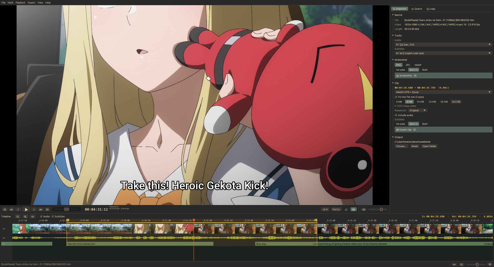
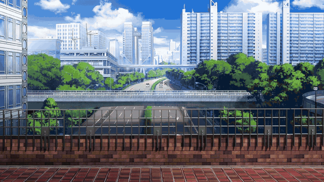
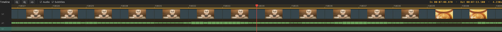
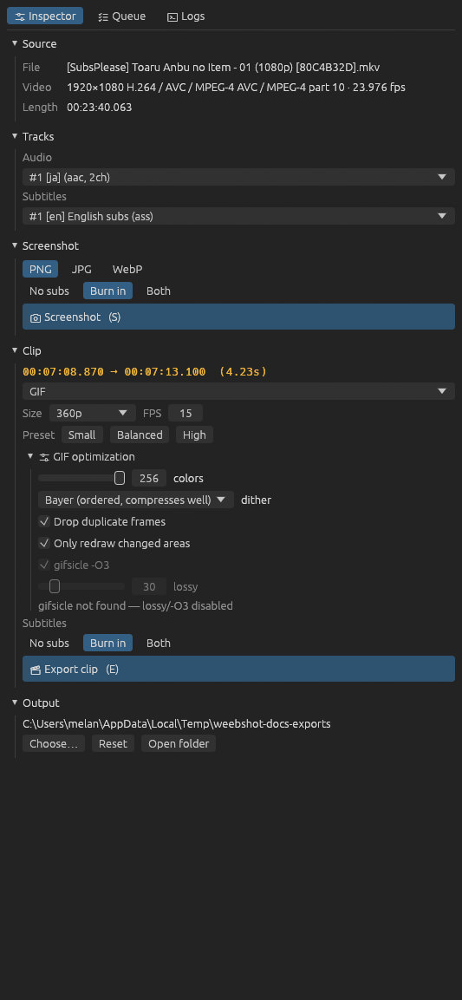
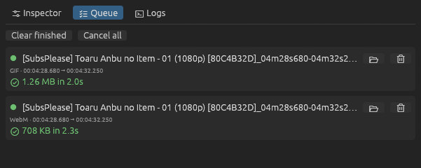
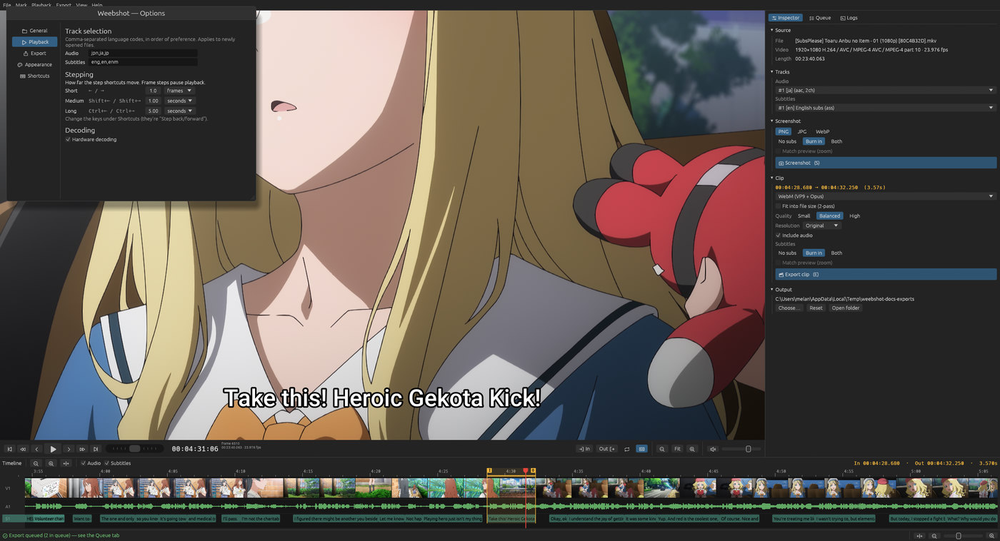
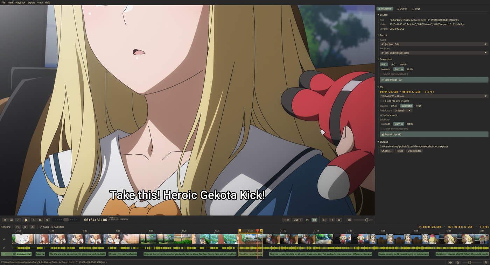

# weebshot

**Frame-accurate anime screenshot & clip maker.**
Open an episode, find the exact frame or line, and save a full-resolution screenshot or cut a
WebM, MP4, MKV, GIF or animated WebP — with the subtitles burned in, without them, or both at once.

[](https://github.com/Melanpan/weebshot/releases/latest)
[](https://github.com/Melanpan/weebshot/actions/workflows/ci.yml)
[](LICENSE)


> [!WARNING]
> **This project was vibecoded** — written largely by an AI coding assistant, with a human steering
> and testing. It works and has a decent test suite, but it hasn't had the scrutiny of a carefully
> hand-written project. Expect rough edges, and please report what you find. (weebshot only ever
> *creates* new files; it never modifies your videos.)



## What it makes

The scene above, marked with one key press on its subtitle line and exported twice:



| | Settings | Size |
| --- | --- | --- |
| [**WebM**](docs/examples/gekota-kick.webm) (click to play) | 1080p, VP9 + Opus, subtitles burned in, *fit into 8 MB* | 3.7 MB · 6.1 s |
| **GIF** (above) | 360p, 15 fps, Balanced preset, duplicate frames dropped | 2.6 MB · 6.1 s |

## Download

| Platform | Download | |
| --- | --- | --- |
| **Windows** 10/11 (x64) | [`weebshot-windows-x64.zip`](https://github.com/Melanpan/weebshot/releases/latest/download/weebshot-windows-x64.zip) | unzip and run `weebshot.exe` |
| **Linux** (x86-64) | [`weebshot-x86_64.AppImage`](https://github.com/Melanpan/weebshot/releases/latest/download/weebshot-x86_64.AppImage) | make executable and run |
| **macOS** (Apple Silicon) | [`weebshot-macos-arm64.zip`](https://github.com/Melanpan/weebshot/releases/latest/download/weebshot-macos-arm64.zip) | right-click → Open the first time · *experimental* |

Everything is included (player, ffmpeg, gifsicle) — no separate installs. weebshot checks for
updates once a day and can update itself on Windows and Linux.
More in [Installing & updating](docs/install.md).

## Features

### Find the exact moment
- **Frame-accurate everything** — arrow keys step one frame (Shift/Ctrl for bigger, configurable
  steps), clicks snap to frames, and you can type a timecode (`00:01:23:12`) or frame number (`#2000`).
- **Editor-style timeline** with a thumbnail filmstrip that shows **every single frame** when you
  zoom in, the **audio waveform**, every **subtitle line** as a block, and chapter markers.
- **Premiere-style shuttle** (and J/K/L keys) for fast forward/backward scanning.
- **Jump between subtitle lines** with ↑/↓ — the quickest way to find a line of dialogue.



### Subtitles done right
- Mark a clip as **exactly one subtitle line** with one key (or a double-click on the timeline).
- Styled **ASS subtitles keep their fonts** — the fonts embedded in the MKV are used, the same
  renderer as the preview. Blu-ray PGS subtitles work too.
- Every export can be **with subs, without, or both** in one go (`…_subbed` / `…_raw`).

### Screenshots
- Saved by the player itself: **the exact frame at full resolution** (not the window size), as PNG,
  JPG or WebP. `S` for the subtitle setting of your choice, `Ctrl+S` for a clean frame.

### Clips
- **WebM** (VP9/Opus), **MP4** (H.264/AAC), **MKV**, **GIF**, **animated WebP**.
- **Fit into a file size** — pick 4 / 8 / 10 / 25 / 50 MB (imageboards, Discord…) and weebshot
  does a 2-pass encode that lands just under it.
- **GPU encoding** with NVIDIA NVENC, Intel Quick Sync or AMD AMF — detected by actually testing them.
- 10-bit sources are converted so clips play everywhere; cuts are frame-accurate.

### GIFs that don't explode
- Optimal palette per clip, **duplicate-frame dropping** (anime is drawn on 2s and 3s),
  changed-area-only encoding, adjustable colors and dithering, optional **gifsicle lossy**
  compression — with Small/Balanced/High presets.

### Nice to work with
- Background **export queue** with progress, retry, and a log of every ffmpeg command.
- **Rebindable shortcuts**, themes (including **Gruvbox**, Nord, Catppuccin, Dracula), UI scaling.
- Built-in **documentation** (F1) that always shows *your* key bindings.
- Little sounds when screenshots and exports are done.

<details>
<summary>More screenshots</summary>

 





</details>

## Documentation

The same pages are built into the app (*Help → Documentation*, or F1):

[Getting started](docs/getting-started.md) ·
[Installing & updating](docs/install.md) ·
[The interface](docs/interface.md) ·
[Timeline & seeking](docs/timeline.md) ·
[Screenshots](docs/screenshots.md) ·
[Clips](docs/clips.md) ·
[GIFs](docs/gifs.md) ·
[Keyboard shortcuts](docs/shortcuts.md) ·
[Options & themes](docs/options.md) ·
[Troubleshooting](docs/troubleshooting.md)

## Building from source

You need [Rust](https://rustup.rs) (stable). At runtime weebshot looks for `ffmpeg` (and optionally
`gifsicle`) next to itself, then on your `PATH`.

**Windows** — with the Visual Studio Build Tools (C++) installed:

```powershell
./scripts/fetch-libmpv.ps1        # downloads libmpv and creates its import library
cargo run --release
./scripts/package.ps1             # optional: zip with ffmpeg + gifsicle in dist/
```

**Linux** (Ubuntu 24.04 or newer, for libmpv 0.37+):

```sh
sudo apt install libmpv-dev ffmpeg gifsicle libxkbcommon-dev libgl1-mesa-dev libwayland-dev \
  libx11-dev libxcursor-dev libxrandr-dev libxi-dev
cargo run --release
./scripts/package-linux.sh        # optional: AppImage in dist/
```

**macOS**:

```sh
brew install mpv ffmpeg gifsicle
LIBRARY_PATH="$(brew --prefix)/lib" cargo run --release
```

Pushing a `v*` tag builds all three platforms on GitHub Actions and publishes a release. See
[CONTRIBUTING.md](CONTRIBUTING.md) for how the code is organised and how to run the tests.

## License

weebshot is free software under the [GNU General Public License v3.0 or later](LICENSE).

It's built on the shoulders of [mpv](https://mpv.io), [FFmpeg](https://ffmpeg.org),
[gifsicle](https://www.lcdf.org/gifsicle/), [egui](https://github.com/emilk/egui) and
[Phosphor icons](https://phosphoricons.com); the release packages include mpv, FFmpeg and gifsicle
under their own licenses — see [THIRD-PARTY.md](THIRD-PARTY.md).
