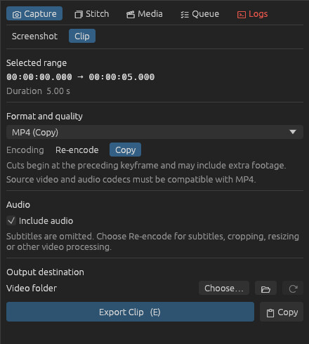

# Clips

1. Mark the range: [I](key:SetIn) / [O](key:SetOut), the `I`/`O` flags on the timeline, or
   [X](key:MarkSubtitleLine) for the subtitle line on screen. Export refuses to run without a range —
   so you never accidentally encode a whole episode.
2. Choose the format and options in **Capture → Clip**.
3. Press [E](key:ExportClip). The export appears in the **Queue** tab, and a chime plays when the
   queue is done (see *Options → General → Sounds*).

## Anime4K

Enable **Anime4K (2×)** in the Clip section for MP4, MKV, WebM, GIF, or animated WebP. Weebshot
applies your crop and subtitle settings, doubles the width and height, then applies the format's
height limit. A 960×540 crop becomes 1920×1080 with no cap, or 1280×720 with a 720p cap.

- **Model and preset** — ACNet and ARNet each offer Fast, Balanced, and Slow. These select
  f8b4, f8b8, and f8b18 for ACNet, and f8b8, f8b16, and f8b32 for ARNet.
  The default is ACNet Balanced.
- **Variant** — Neutral is the default. Choose Denoise for mild noise reduction,
  Line restoration for stronger line reconstruction, or Line restoration + denoise for both.
- **Device** — Auto tries a compatible OpenCL GPU and reports CPU fallback in the Queue and
  Logs tabs. GPU mode requires a driver exposing a compatible OpenCL GPU. CPU works without a
  GPU driver. This choice is independent of the clip's hardware video encoder.

Weebshot stores two lossless FFV1 videos in the system temporary directory until the export
finishes. Space depends on the clip length, crop, frame rate, and how well the frames compress.
For scale, the two intermediates for a 10-second 1080p clip at 24 fps would occupy about 15 GB
before FFV1 compression. A lower final height cap still uses the full 2× intermediate.

## Copy exported files to clipboard

Click **Copy** beside Export Clip or press [Shift+E](key:CopyClip). Weebshot exports using
the current settings, then copies the completed files so you can paste them into an
application that accepts file attachments. With **Both** subtitle variants selected,
both files are copied after they finish. A failed or cancelled export does not replace
the clipboard with a partial set.

## Formats

| Format | Re-encoded video / audio | Good for |
| --- | --- | --- |
| WebM | VP9 + Opus | Imageboards, Discord, the web. Best quality per MB. |
| MP4 | H.264 + AAC | Plays everywhere (phones, Twitter/X, messengers). |
| MKV | H.264 + Opus | Archiving a cut. |
| GIF | — | Places that only take GIFs. Large; see [GIFs](gifs.md). |
| Animated WebP | — | A much smaller GIF alternative where supported. |

Re-encoded video is converted to 8-bit 4:2:0 for broad playback compatibility, with frame-accurate cuts.

## Copy without re-encoding

For **MP4** and **MKV**, choose **Copy** under **Encoding** to preserve the original video
and selected audio track. **Include audio** still controls whether that track is included.
Copy mode uses the existing export queue and supports the Export Clip and clipboard actions.
Re-encode is the default. The chosen mode is saved between launches.

The cut begins at the preceding keyframe, so the exported clip may include footage before
the In marker. File size and exact cut timing depend on the source. MP4 requires source
codecs supported by its container. Incompatible streams produce an export error.

Subtitles are omitted in Copy mode. Quality, target size, resolution, frame rate, cropping,
loop count, and video processing settings apply when **Re-encode** is selected. Switching
modes preserves those settings.

## Quality or file size

- **Quality** — *Small*, *Balanced*, *High*. Constant quality; the file is as big as it needs to be.
- **Fit into file size** — pick 4 / 8 / 10 / 25 / 50 MB or type a value. Weebshot computes the
  bitrate and encodes in two passes so the result lands just under the limit. If the limit is too
  tight for the clip length it tells you before starting, and hints at a lower resolution when that
  would look better (e.g. *consider 720p*).

## Match preview (zoom)

Zoom into the preview (the zoom buttons under it, or Ctrl+wheel over the picture) and tick
**Match preview (zoom)** to export just the area you see. The crop is taken when you press
Export; its size is shown next to the checkbox. Burned-in text subtitles are drawn at their normal
size at the bottom of the cropped picture (image subtitles are cropped along with the frame).

## Resolution and audio

- **Resolution** — *Original* or a maximum height (1080p … 240p). Never upscales.
- **Frame rate** — *Original* or a maximum (60 … 12 fps). Never adds frames above the source rate.
- **Include audio** — uses the audio track selected in **Media → Tracks**. Re-encoding
  downmixes it to stereo; Copy preserves its original channels and codec.

## Loop

With **Re-encode** selected, set **Loop** to repeat the clip's content 1–20 times in the output file — for turning a short cut
into a loop video. Audio loops in sync with the video, and it works for every format. Before
exporting, check the seam with [Ctrl+Space](key:PlayFromIn) or [Shift+Space](key:PlayToOut) — see
[Timeline & seeking](timeline.md) (*Looping*).

## Subtitles

- *No subs*, *Burn in*, or *Both* (two files: `…_subbed` and `…_raw`, queued together).
- Styled ASS subtitles keep their fonts — the fonts attached to the MKV are used. If you've edited,
  deleted or retimed any lines on the timeline, the export burns in those edits (see
  [Timeline & seeking](timeline.md)).
- Image subtitles (PGS from Blu-rays) are supported when they're inside the video file.
- External subtitle files work too, whether mpv loaded them automatically (e.g. `episode.ass` next
  to `episode.mkv`) or you picked one yourself with *File → Load subtitle file…*.

## Encoder speed

*Options → Export* sets the H.264 preset and VP9 speed. Slower = smaller files at the same quality.

## Hardware (GPU) encoding

MP4 and MKV can be encoded on the graphics card — NVIDIA NVENC, Intel Quick Sync or AMD AMF —
which is several times faster than the CPU, at the cost of slightly bigger files for the same
quality. In *Options → Export → Hardware encoding*, click **Detect GPU encoders**: Weebshot encodes
a short test clip with each one and lists which actually work with your GPU and drivers. Then pick
one under *Use for MP4/MKV*.

With *Fit into file size*, GPU encoders don't do the two-pass analysis; they use a capped bitrate
aiming a bit under the limit instead. WebM, GIF and WebP always use the CPU.
