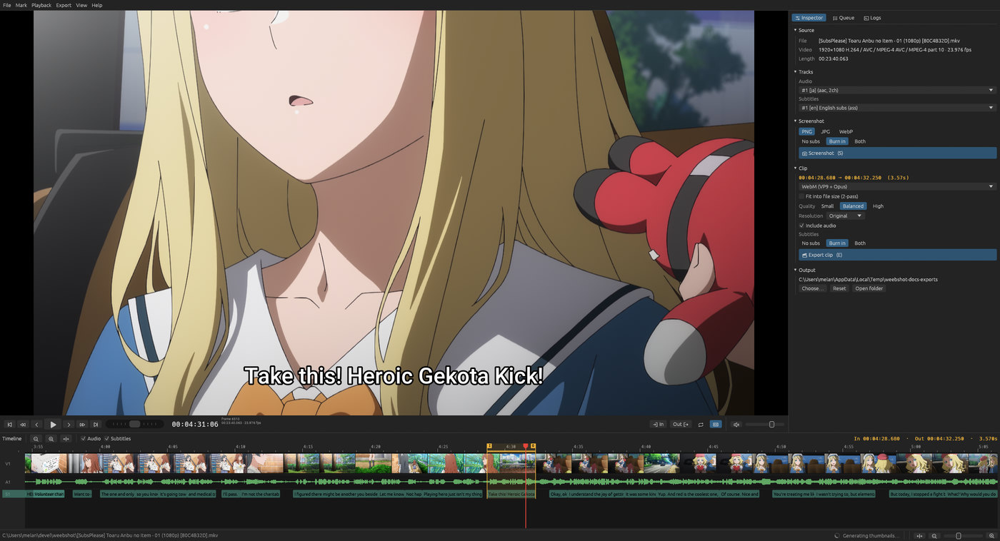
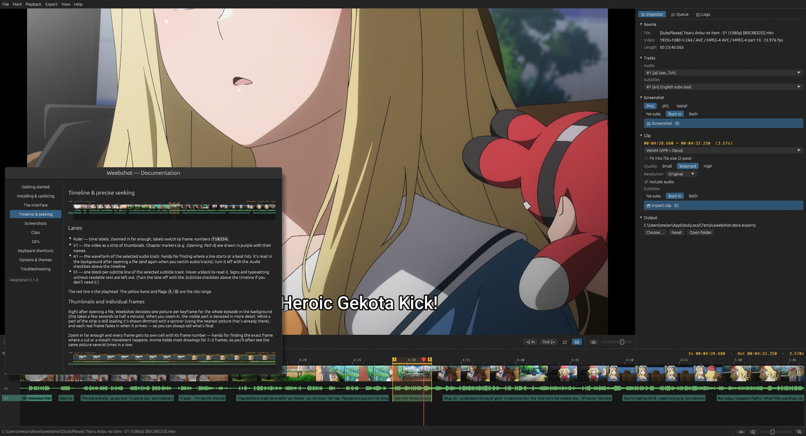

# Getting started

Weebshot is a small tool for grabbing **screenshots** and cutting **clips** (WebM, MP4, MKV, GIF,
animated WebP) out of anime episodes — with or without the subtitles burned in.

## The 30-second version

1. **Open an episode** — drag a file onto the window, or use *File → Open…* ([Ctrl+O](key:Open)).
2. **Find the moment** — play with [Space](key:PlayPause), step frames with [←](key:FrameBack) / [→](key:FrameForward)
   (hold Shift or Ctrl for bigger steps), jump between subtitle lines with [↑](key:PrevSubtitle) /
   [↓](key:NextSubtitle), push the shuttle ([J](key:ShuttleBack) / [K](key:ShuttleStop) / [L](key:ShuttleForward)),
   or click/drag on the timeline. Ctrl+click a subtitle line on the timeline to hear just that line.
3. **Screenshot** — press [S](key:Screenshot). The current frame is saved at full resolution.
4. **Clip** — set the start with [I](key:SetIn) and the end with [O](key:SetOut)
   (or press [X](key:MarkSubtitleLine) to mark exactly the subtitle line on screen), pick a format in the
   inspector on the right, and press [E](key:ExportClip).

Exports run in the background; watch them in the **Queue** tab of the side panel (or the progress
wheel in the status bar).

## What you need

Nothing extra: the downloads include everything (see [Installing & updating](install.md)).

Weebshot uses two helper programs, which it looks for next to itself first and then on your `PATH`:

- **ffmpeg** — clip exports, and reading thumbnails, the audio waveform and subtitle timings.
- **gifsicle** *(optional)* — makes GIFs noticeably smaller.

If you built Weebshot yourself, install them separately or point to them in *Options → Export*.

## Help inside the app

Press [F1](key:Docs) (or *Help → Documentation*) for these pages inside weebshot. They're built from
the same files as this documentation, and every shortcut shown matches your current key bindings.

## Where files go

By default, next to the video you opened. Change it in the inspector's **Output** section or in
*Options → General*, where you can also change the file name pattern.
