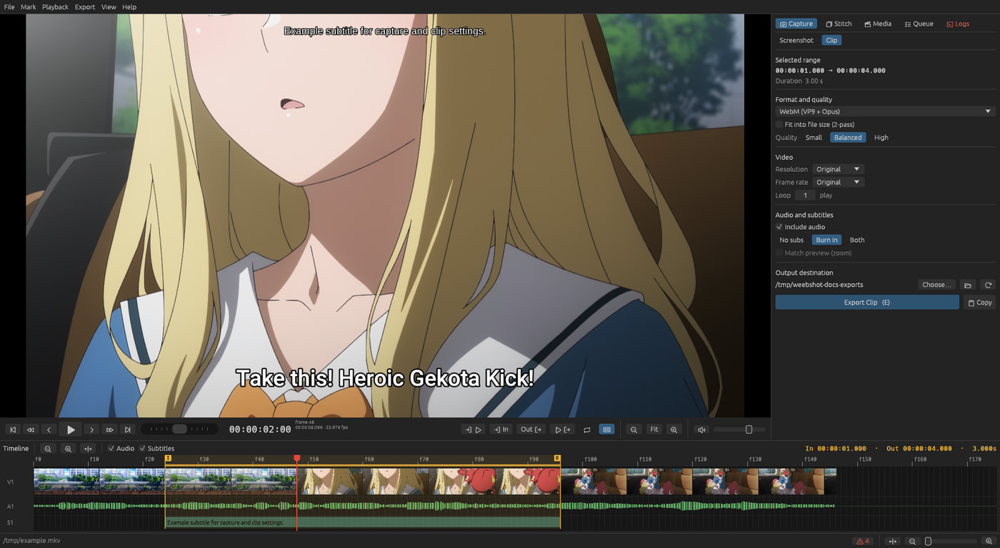
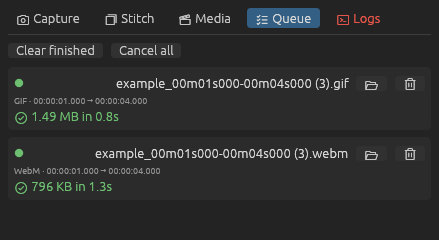
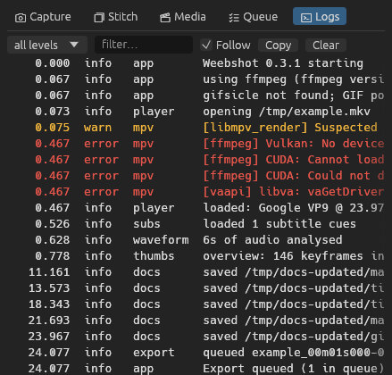

# The interface

- **Top** — the menu bar: *File*, *Mark*, *Playback*, *Export*, *View*, *Help*.
- **Middle** — the viewer, with the transport bar under it.
- **Right** — the side panel with five tabs: **Capture**, **Stitch**, **Media**, **Queue** and **Logs**.
- **Bottom** — the [timeline](timeline.md) and the status bar.

Drag the sidebar's left edge to resize it. Its last selected tab is restored at launch;
Capture opens by default. Switching tabs or capture modes preserves their settings.
Options, Help, About and the update window open as separate windows.

## Status bar

From left to right:

- the last message (*Saved …*, errors) or the open file's path;
- on the right: the **timeline zoom** slider with zoom in/out/fit buttons, a red counter when an
  error was logged, an **Update to …** button when a new version is out, background work for the
  open file (*Generating thumbnails…*, *Reading audio 63%*, *Reading subtitles…*) with a progress
  wheel, and export progress — click it to open the Queue.

## Viewer and transport

The video plays in the middle. Click it to play/pause. **Right-click** it for:

- **Zoom** — *Fit* (default), *50%*, *100%* (one video pixel per screen pixel, for checking detail),
  *200%*, or *Fill* (crop to fill the viewer). **Ctrl + wheel** over the picture zooms smoothly
  around the pointer (zoom back to the window size and it snaps to *Fit*). When zoomed in, drag the
  picture to pan.
- **Aspect ratio** — override it for badly flagged files (16:9, 4:3, 2.39:1, 1:1).
- **Fullscreen** ([F11](key:Fullscreen)), *Show subtitles*, the audio/subtitle track lists, both
  screenshot kinds, Set In/Out, *Copy timecode*, and hiding the side panel.

The transport bar under it, from left to right:

| Control | Does |
| --- | --- |
| Skip back / skip forward (outer buttons) | Go to the In / Out point |
| Rewind / fast-forward | Medium step back / forward |
| Caret left / right | Short step (one frame by default) |
| Play | Play / pause |
| **Shuttle** (the slider with the knob) | Push the knob right to play faster, left to play backwards — the further, the faster (¼× up to 16×). Let go and it springs back and stops. Scroll over it to change the speed in steps. Same as [J](key:ShuttleBack) / [K](key:ShuttleStop) / [L](key:ShuttleForward). |
| Timecode | `HH:MM:SS:FF`, with the frame number and frame rate next to it. Click it to type a position. |
| In / Out | Mark the current frame as the clip start / end |
| Play In→Out / Play to Out | Preview the marked range once: play from In through Out, or from wherever you are to Out ([Ctrl+Space](key:PlayFromIn) / [Shift+Space](key:PlayToOut)) |
| Zoom − / Fit / + | Zoom the picture: [Ctrl+-](key:ViewZoomOut) / [Ctrl+=](key:ViewZoomIn), back to fit with [Ctrl+0](key:ViewZoomFit). Click the percentage for presets. **Ctrl+wheel** over the picture zooms at the pointer; drag to pan. |
| Subtitles (CC) | Show/hide subtitles in the preview ([C](key:ToggleSubtitles)). Only the preview — screenshots and exports still burn them in if asked. |
| Loop | Loop playback between In and Out |
| Speaker + slider | Mute and volume |

The transport switches to two rows when the viewer becomes narrower. At very narrow widths,
each row can be scrolled horizontally to reach all controls.
Every action button shows its shortcut when you hover it. Capture's primary actions also
display their current shortcut on the button.

## Capture

Switch between **Screenshot** and **Clip** to configure and export each type. Both use the same
output destination as Stitch. **Choose…** sets a directory, the folder button opens it,
and Reset restores saving beside the source video. Hover a shortened path to see it in full.

**Take Screenshot** ([S](key:Screenshot)) and **Export Clip** ([E](key:ExportClip)) save files.
The adjacent **Copy** button copies a screenshot image ([Ctrl+Shift+C](key:CopyScreenshot))
or exports the clip and copies its finished files ([Shift+E](key:CopyClip)).
See [Screenshots](screenshots.md) and [Clips](clips.md) for options, including MP4/MKV
stream copying.

## Stitch

Choose a method, then use **Auto Stitch** ([Shift+S](key:AutoStitch)) to discover the pan
around the playhead, or mark In and Out and use **Stitch Selection**
([Alt+Shift+S](key:StitchSelection)). Both actions use the marked range when both marks exist.
**Advanced** contains the existing sampling and frame-spacing controls.

The result window lets you review the stitch, adjust included frames, save it, or copy the image.
See [Auto Stitch](stitching.md) for the complete workflow.

## Media

**Source** shows the filename, resolution, codec, frame rate, duration, and chapter count.
**Tracks** lets you change the playback audio and subtitles or load an external subtitle file.

## Queue

Every export with its progress, one card per file. A running export shows a **progress wheel**
next to its name (it spins while a step can't measure progress, like building a GIF palette).
Finished exports can be shown in Explorer; failed ones can be retried. Exports run one at a time,
in order.

While something is exporting, the status bar at the bottom right shows the same wheel with the
current step — click it to jump to the Queue. [Ctrl+J](key:ToggleDock) switches between the
Capture and Queue.

## Logs

What Weebshot, mpv and ffmpeg reported, including the exact ffmpeg command lines.
Release builds open at **info+**. Select **all levels** to see debug details such as
individual Auto Stitch alignment attempts.
Filter by level or text; *Copy* puts the whole log on the clipboard (handy for bug reports).
The Logs tab turns red when an error has been logged since you last looked. Hover it to see
the unread count. The status bar also shows the count.

## Menus

Every action in the menus shows its current shortcut on the right. Shortcuts can be changed in
*Options → Shortcuts*. *View → Side panel* hides the right panel for a bigger video.
