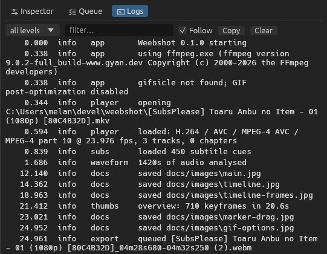

# The interface

- **Top** — the menu bar: *File*, *Mark*, *Playback*, *Export*, *View*, *Help*.
- **Middle** — the viewer, with the transport bar under it.
- **Right** — the side panel with three tabs: **Inspector**, **Queue** and **Logs**.
- **Bottom** — the [timeline](timeline.md) and the status bar.

Options, Help, About and the update window open as separate windows.

## Status bar

From left to right:

- the last message (*Saved …*, errors) or the open file's path;
- on the right: the **timeline zoom** slider with zoom in/out/fit buttons, a red counter when an
  error was logged, an **Update to …** button when a new version is out, background work for the
  open file (*Generating thumbnails…*, *Reading audio 63%*, *Reading subtitles…*) with a progress
  wheel, and export progress — click it to open the Queue.

## Viewer and transport

The video plays in the middle. Click it to play/pause. **Right-click** it for:

- **Zoom** — *Fit* (default), *50%*, *100%* (one video pixel per screen pixel, for checking detail),
  *200%*, or *Fill* (crop to fill the viewer). **Ctrl + wheel** over the picture zooms smoothly
  around the pointer (zoom back to the window size and it snaps to *Fit*). When zoomed in, drag the
  picture to pan.
- **Aspect ratio** — override it for badly flagged files (16:9, 4:3, 2.39:1, 1:1).
- **Fullscreen** ([F11](key:Fullscreen)), *Show subtitles*, the audio/subtitle track lists, both
  screenshot kinds, Set In/Out, *Copy timecode*, and hiding the side panel.

The transport bar under it, from left to right:

| Control | Does |
| --- | --- |
| Skip back / skip forward (outer buttons) | Go to the In / Out point |
| Rewind / fast-forward | Medium step back / forward |
| Caret left / right | Short step (one frame by default) |
| Play | Play / pause |
| **Shuttle** (the slider with the knob) | Push the knob right to play faster, left to play backwards — the further, the faster (¼× up to 16×). Let go and it springs back and stops. Scroll over it to change the speed in steps. Same as [J](key:ShuttleBack) / [K](key:ShuttleStop) / [L](key:ShuttleForward). |
| Timecode | `HH:MM:SS:FF`, with the frame number and frame rate next to it. Click it to type a position. |
| In / Out | Mark the current frame as the clip start / end |
| Subtitles (CC) | Show/hide subtitles in the preview ([C](key:ToggleSubtitles)). Only the preview — screenshots and exports still burn them in if asked. |
| Loop | Loop playback between In and Out |
| Speaker + slider | Mute and volume |

Every button shows its shortcut when you hover it.

## Inspector

The first tab of the side panel. Every section can be collapsed.

- **Source** — resolution, codec, frame rate, length and chapters of the open file.
- **Tracks** — audio and subtitle track. The preview uses exactly these tracks, and so do exports:
  what you see is what you get.
- **Screenshot** / **Clip** — format and options, see [Screenshots](screenshots.md) and [Clips](clips.md).
- **Output** — where files are saved.

## Queue

Every export with its progress, one card per file. A running export shows a **progress wheel**
next to its name (it spins while a step can't measure progress, like building a GIF palette).
Finished exports can be shown in Explorer; failed ones can be retried. Exports run one at a time,
in order.

While something is exporting, the status bar at the bottom right shows the same wheel with the
current step — click it to jump to the Queue. [Ctrl+J](key:ToggleDock) switches between the
Inspector and the Queue.

## Logs

What Weebshot, mpv and ffmpeg reported, including the exact ffmpeg command lines.
Filter by level or text; *Copy* puts the whole log on the clipboard (handy for bug reports).
A red warning counter on the tab and in the status bar means an error was logged since you last looked.

## Menus

Every action in the menus shows its current shortcut on the right. Shortcuts can be changed in
*Options → Shortcuts*. *View → Side panel* hides the right panel for a bigger video.
