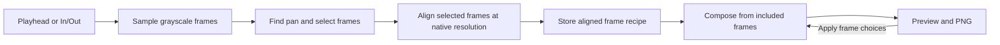

# Frame stitching

[Auto Stitch](../stitching.md) reconstructs artwork that a camera pan reveals over time.
The engine models each frame as a rectangular view into the same image, with its own
horizontal and vertical offset. This works for vertical and horizontal pans and small
diagonal translations. A fallback handles a limited form of parallax with two independent
vertical translations. An explicit Shift and scale method handles uniform zoom
on one plane. Rotation and perspective changes remain unsupported.

## Pipeline



The [app layer](../../src/app/stitching.rs) captures the source, playhead, marks and settings,
then submits work to the existing [export runner](../../src/export/mod.rs). Stitching shares
the serial background worker with clip exports. Progress and results reach egui through job
events. The [engine](../../src/stitch/mod.rs) can run without the GUI.

Playback stays with libmpv. Stitching uses the existing FFmpeg executable to read the first
video stream from the source file. Player zoom, subtitles rendered by mpv and playback position
changes have no effect on the decode. FFmpeg applies video orientation, and subtitles already
burned into the picture remain part of the source pixels.

## Sampling and boundary detection

When both In and Out are present, the marked range is authoritative. Otherwise Auto Stitch
looks around the playhead, with a default search limit of 15 seconds in each direction.
The engine probes source dimensions and pixel aspect ratio, then streams grayscale samples
scaled to roughly 320 pixels on the long edge. The initial sampling rate defaults to 8 FPS.
If discovery fails or a candidate has unreliable adjacent matches, the engine can retry at
higher rates within the source rate and sample budget.

The [motion estimator](../../src/stitch/motion.rs) builds a small grayscale pyramid.
It searches translations on the coarsest level, retains several distinct hypotheses and
refines them on progressively larger levels. It samples a 4×4 grid of tiles in the overlap.
The residual averages the 12 best tiles, while a separate support score counts how many
of all 16 tiles agree. This lets a local animation affect a few tiles without dominating
the match. Flat images with too little detail and poorly supported matches are unreliable.

For adjacent frames A and B, the offset is defined by
`A(x + dx, y + dy) ≈ B(x, y)`. If A starts at `pA` in artwork coordinates, B starts
at `pA + (dx, dy)`. Positive x points right and positive y points down, so a negative dy
indicates the camera moved up while the artwork moved down on screen.

Automatic discovery seeds a moving pair near the playhead, then extends in both directions
while motion remains consistent. Brief holds are allowed by default. A longer baseline of
roughly half a second can detect slow motion when adjacent downscaled samples round to zero.
Low detail, poor agreement and inconsistent direction can end the automatic region.
Scene cuts are handled through these match signals. A marked range skips boundary discovery
and reports incompatible motion or cuts found during analysis.

The engine accumulates translations to estimate positions and rechecks older overlapping
frames to reduce drift. It chooses a frame when travel since the previous selection reveals
enough new image, normally around 8% of a frame dimension, and includes the endpoint when
it adds coverage. Duplicate positions add no coverage. The analysis is capped at 1,000
samples and the native selection at 96 frames.

## Native decode and alignment

The [decoder](../../src/stitch/decode.rs) uses the same FFmpeg FPS filter grid in the
grayscale and native passes. A frame index refers to a sample on this grid. The timestamp
shown in the frame picker is the nominal sample time, `start + index / fps`.

Native decoding seeks shortly before the first requested sample. When it skips ahead,
it restores the skipped timestamp offset before applying the FPS filter, keeping the
sample grid aligned with the analysis pass. FFmpeg's `select` filter emits only the
requested RGB frames, and `-frames:v` stops the process after that many outputs. A
post-filter time limit alone can leave FFmpeg reading to the end of an episode because
the selector has stopped producing frames. FFmpeg may still decode intervening frames
internally to reach the samples.

Native alignment predicts the shift from the **difference** between the current and
reference analysis positions, scaled per axis to native pixels. It refines that shift
against the reference image and adds the result to the reference's **refined** position.
This keeps coarse estimates and corrected positions in their respective coordinate
systems. Up to three recent grayscale references and their reduced images are cached.
Older eligible references are tried first to limit error from chaining successive offsets.

The native pass applies stricter tile thresholds and checks line-art agreement across
the overlap. A flat background can agree strongly even when a character's outlines
belong to a different pose. The extra check measures agreement on strong gradients
and rejects low-agreement candidates when enough edges are available. If no reference
can align a frame, it starts a separate component. The engine keeps the component
with the greatest normalized travel that meets minimum frame count and travel
requirements. This can shorten the final range, which the preview reports.

The displayed confidence summarizes the weakest retained native match using tile residual
and support. Edge agreement is a separate acceptance gate. The confidence describes global
registration, so moving objects can still leave visible discontinuities at a high score.

## Canvas and seams

The [composer](../../src/stitch/compose.rs) computes bounds from the included native frame
positions and translates the minimum x and y to the canvas origin. The canvas supports
up to 16,384 pixels per edge and 32 million pixels total. It streams one native RGB frame
at a time into an RGBA canvas. Uncovered corners from diagonal motion stay transparent.

Where a new frame overlaps the canvas, the dominant direction of that step determines
which way the seam crosses the overlap. A reduced grid measures RGB differences with
a small tolerance for compression noise. A connected-region pass groups substantial
differences and penalizes paths through their padded bounds. This encourages the seam
to stay on one side of a moving limb or other pose change, including areas inside the
region where two poses happen to have similar colors.

Dynamic programming finds a low-cost path across the grid and interpolates it back to
native coordinates. The composer takes each covered pixel from a single decoded frame.
This preserves line detail and avoids ghosting from repeated averaging. If the overlap
offers no clean path around a moving region, the seam can remain visible. The preview
lets the user inspect the result and try a different set of frames.

## Frame choices, preview and export

Alignment produces a reusable recipe containing the source path, sample grid,
native positions, small thumbnails and match diagnostics. The frame picker lists
the aligned candidates in the retained component. It can exclude or restore these
candidates. Frames rejected during detection or alignment are outside the recipe.

**Apply** queues recomposition using the saved positions and decodes only the included
samples for composition. Detection and native alignment are skipped. At least two
frames are required, and the remaining frames must cover a connected span that the
composer can assemble. If a removal creates an overlap gap, restore an intermediate
frame. A failed or cancelled recomposition keeps the last successful result.
**Retry** runs a fresh stitch and rebuilds the candidate list.

The engine writes a temporary native-resolution RGBA PNG and produces a smaller preview
texture. The [PNG writer](../../src/stitch/png.rs) preserves sample aspect ratio through
`pHYs` metadata, and the preview uses the same aspect ratio for display. **Save PNG**
copies the generated artifact to the chosen destination without re-encoding.
The source file is read-only, and temporary artifacts are removed when their last
owner releases them.

## Two-layer vertical pans

When Automatic cannot produce a stable single-translation stitch, or the user
selects Two vertical layers explicitly, the
[layered matcher](../../src/stitch/layers.rs) checks the full analysis window, or
the marked range for Stitch Selection. It tries vertical dividers at one third, one half, and two thirds of the frame width. The explicit method
also accepts a user-specified divider between 20% and 80% of the frame width. For each divider it matches both sides independently
on adjacent grayscale samples. Both tracks must stay reliable and move in the
same direction, with enough difference in total travel to justify a second track.
The whole layered analysis window must be coherent. Mark In/Out
when the layered pan is surrounded by other shots.

The faster track controls adaptive frame selection. Native alignment checks both
tracks against up to three references, including line-art agreement. The recipe
stores two offsets per frame, so editing the frame selection can reuse the
alignment. Each side is composed at native resolution with its own overlap seams.
The output uses the vertical extent covered by both sides and joins them at the
divider. The preview flags that join for inspection. The fallback cannot track
moving silhouettes, separate occluding layers, or compensate for changes in scale.

## Shift and scale

The [shift-and-scale matcher](../../src/stitch/zoom.rs) searches two-dimensional
translation and uniform scale about the image center. Translation seeds a
coarse-to-fine search on downscaled samples. The score checks textured pixels
across the overlap and penalizes large residuals. The matcher composes the
pairwise transforms and selects frames using both center travel and scale change.
It then refines selected frames against up to three native-resolution references
to limit drift.

The resulting recipe stores each frame's scale and canvas position, so changing
the frame selection reuses the solved transforms. Composition resamples scaled
frames into the first frame's pixel grid and reuses the overlap seams. The canvas
covers the union of the transformed frames and can have transparent edges.
This method runs only when explicitly selected and requires coherent alignment
throughout the analyzed interval.

## Experimental layered motion

The [layered motion matcher](../../src/stitch/foreground.rs) samples a marked
vertical pan at 2 FPS. It matches textured patches in a high-pass grayscale image
by normalized correlation, then fits up to five shift-and-scale models by
consensus. It requires at least two motions with different speeds in the same
vertical direction. The user chooses the faster foreground group or the slower
background group. The engine accumulates the chosen transforms and stitches
the resulting views with the existing overlap compositor. This can recover the
overall illustration even when a single global model fails. Overlapping artwork
is still resampled using one chosen transform per frame, so parts with different
motions can show seams.

## Layered Photoshop export

PSD export reuses the recipe, decoder, frame selection, and compositor. While
composing, it records the final source frame for each output pixel. Each
positioned frame keeps its full aligned bitmap and receives an editable mask
showing which of its pixels appear in the stitch. With Two vertical layers,
each frame contributes two independently positioned bitmap layers. The full
canvas is also stored as the document's merged image. The [ag-psd writer](https://docs.rs/ag-psd)
serializes the document. Because it needs in-memory image and mask data, the job
checks the total layer and canvas sizes first. Export runs on the shared worker
and writes through the image export staging path.

## Performance and debugging

Analysis retains downscaled samples. Native alignment retains a bounded set of grayscale
anchors. Composition retains the output canvas, one decoded RGB frame and bounded seam
buffers. The engine drops analysis and alignment buffers before composition. These
limits bound the engine's major allocations. FFmpeg and the application have their
own memory usage.

FFmpeg stdout is read through a bounded channel and stderr is drained separately.
The worker checks cancellation during decoding, alignment and composition. On decoder
failure or cancellation it terminates and reaps the child process. Stage progress
describes work completed within the pipeline rather than estimating remaining time.

Use a release build for profiling. If native alignment is slow, measure decoding and
matching separately. The decoder fixture tests check both early termination and sampling
phase after a seek. For a seam regression, check the retained time span and the native
anchor diagnostics in the logs. Tile support and edge agreement can disagree when a
large background is stable and the foreground changes pose.

## Tests

```sh
cargo test stitch -- --nocapture
```

The [stitch tests](../../src/stitch/tests.rs) generate deterministic artwork and simulate
camera paths. They check alignment, canvas dimensions, coverage and reconstruction error,
including pauses, duplicate frames, diagonal and reversed motion, cuts, foreground animation,
compression noise, low detail, limits and cancellation. Tests also cover frame deselection,
restoration and gaps. The slow-pan test reports timing and, on Linux, process peak RSS
from `VmHWM`, which excludes FFmpeg child processes.

When FFmpeg is available, tests generate lossless video fixtures for automatic and manual
stitching, sample-grid equivalence after seeking, bounded native decode and aspect ratio.
Linux CI installs FFmpeg. The ignored regressions below require the specific reported clip
or original episode, kept outside the repository.

```sh
WEEBSHOT_STITCH_SAMPLE="/path/to/reported-pan.webm" \
  cargo test --release reported_anime_pan_pose_change -- --ignored --nocapture

WEEBSHOT_STITCH_FULL_SAMPLE="/path/to/original-episode.mkv" \
  cargo test --release original_episode -- --ignored --nocapture --test-threads=1

WEEBSHOT_STITCH_FULL_SAMPLE="/path/to/original-episode.mkv" \
  cargo test --release original_pan_at_different_playheads -- --ignored --nocapture

WEEBSHOT_LAYERED_PAN_SAMPLE="/path/to/reported-layered-pan.webm" \
  cargo test --release reported_overlapping_layers_are_rejected -- --ignored

WEEBSHOT_LAYERED_PAN_SAMPLE="/path/to/reported-layered-pan.webm" \
  cargo test --release reported_overlapping_layers_experimental_preview -- --ignored
```

The original-episode decode comparison deliberately runs the legacy slow decode path
and compares its frame bytes with the bounded implementation.
The layered-pan regression checks that both actions and the explicit Shift and
scale method reject the reported Chitose clip, where overlapping planes and scale
changes require separate transforms and occlusion handling. The experimental
regression checks that both priorities produce a preview. Set
`WEEBSHOT_LAYERED_PREVIEW` or `WEEBSHOT_LAYERED_PSD` to keep an export for
inspection. Synthetic fixture tests also verify pixel-exact two-layer output,
scale alignment, frame deselection, and that PSD layers with their masks
reconstruct the merged image.
