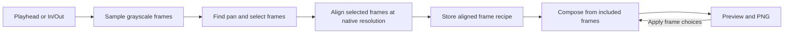

# Frame stitching

[Auto Stitch](../stitching.md) reconstructs artwork that a camera pan reveals over time.
The engine models each frame as a rectangular view into the same image, with its own
horizontal and vertical offset. This works for vertical and horizontal pans and small
diagonal translations. A fallback handles a limited form of parallax with two independent
vertical translations. A Shift, scale and rotation method handles uniform zoom and
camera roll on one plane; Automatic falls back to it last. Perspective changes
remain unsupported.

## Pipeline



The [app layer](../../src/app/stitching.rs) captures the source, playhead, marks and settings,
then submits work to the existing [export runner](../../src/export/mod.rs). Stitching shares
the serial background worker with clip exports. Progress and results reach egui through job
events. The [engine](../../src/stitch/mod.rs) can run without the GUI.

Playback stays with libmpv. Stitching uses the existing FFmpeg executable to read the first
video stream from the source file. Player zoom, subtitles rendered by mpv and playback position
changes have no effect on the decode. FFmpeg applies video orientation, and subtitles already
burned into the picture remain part of the source pixels.

## Sampling and boundary detection

When both In and Out are present, the marked range bounds the search. Otherwise Auto Stitch
looks around the playhead, first within 6 seconds in each direction. If the discovered
pan reaches that window's edge, the window widens to the search limit, 15 seconds by
default, and analysis repeats. Most pans are short, so this avoids decoding unrelated
shots.
The engine probes source dimensions and pixel aspect ratio, then streams grayscale samples
scaled to roughly 320 pixels on the long edge. The initial sampling rate defaults to 8 FPS.
If discovery fails or a candidate has unreliable adjacent matches, the engine can retry at
higher rates within the source rate and sample budget.

The [motion estimator](../../src/stitch/motion.rs) builds a small grayscale pyramid.
It searches translations on the coarsest level, retains several distinct hypotheses and
refines them on progressively larger levels. It samples a 4×4 grid of tiles in the overlap,
with about one sample every 4 pixels (24 to 256 per axis). A sparse fixed grid lands
mostly on flat anime fills at 1080p, leaving the sideways cost nearly flat.
The residual averages the 12 best tiles, while a separate support score counts how many
of all 16 tiles agree. This lets a local animation affect a few tiles without dominating
the match. Flat images with too little detail and poorly supported matches are unreliable.

For adjacent frames A and B, the offset is defined by
`A(x + dx, y + dy) ≈ B(x, y)`. If A starts at `pA` in artwork coordinates, B starts
at `pA + (dx, dy)`. Positive x points right and positive y points down, so a negative dy
indicates the camera moved up while the artwork moved down on screen.

Automatic discovery seeds a moving pair near the playhead, then extends in both directions
from that pair while motion remains consistent. The walk starts at the pair, not at the
playhead frame: a playhead resting on a hold or on a pair that does not match (the first
frame of a clip whose camera is already rolling) would otherwise end it immediately.
If that region does not produce a stitch, up to three further regions in the window are
attempted, nearest the playhead first. Only regions whose analysis travel reaches the
minimum are considered, and each attempt passes the same checks. The error reported
when all fail is the first one. A marked range is first attempted whole. If that fails,
the same regions inside the range are attempted in order of decreasing travel, since the
playhead says nothing about which part of a marked range matters, and the result is
reported as a shortened range. Brief holds are allowed by default. A longer baseline of
roughly half a second can detect slow motion when adjacent downscaled samples round to zero.
Low detail, poor agreement and inconsistent direction can end the automatic region.
Scene cuts are handled through these match signals. A marked range skips boundary discovery.
If the range still has unreliable pairs after retrying at a higher rate, the engine keeps
the run of at least two consecutive reliable pairs that reveals the most, and the preview
reports the shortened range. A single matching pair is ignored: two shots can agree on
flat fills.

The engine accumulates translations to estimate positions and rechecks older overlapping
frames to reduce drift. It chooses a frame when travel since the previous selection reveals
enough new image, normally around 8% of a frame dimension, and includes the endpoint when
it adds coverage. Duplicate positions add no coverage. The analysis is capped at 1,000
samples and the native selection at 96 frames.

## Native decode and alignment

The [decoder](../../src/stitch/decode.rs) uses the same FFmpeg FPS filter grid in the
grayscale and native passes. A frame index refers to a sample on this grid. The timestamp
shown in the frame picker is the nominal sample time, `start + index / fps`.

Native decoding seeks shortly before the first requested sample. When it skips ahead,
it restores the skipped timestamp offset before applying the FPS filter, keeping the
sample grid aligned with the analysis pass. FFmpeg's `select` filter emits only the
requested RGB frames, and `-frames:v` stops the process after that many outputs. A
post-filter time limit alone can leave FFmpeg reading to the end of an episode because
the selector has stopped producing frames. FFmpeg may still decode intervening frames
internally to reach the samples.

Native alignment predicts the shift from the **difference** between the current and
reference analysis positions, scaled per axis to native pixels. It refines that shift
against the reference image and adds the result to the reference's **refined** position.
This keeps coarse estimates and corrected positions in their respective coordinate
systems. Up to three recent grayscale references and their reduced images are cached.
Older eligible references are tried first to limit error from chaining successive offsets.
An older reference is accepted immediately only when its edge agreement is strong (0.7).
Otherwise every acceptable reference is compared and the best-agreeing one is used, since
the oldest frame differs most through animation.

The native pass applies stricter tile thresholds and checks line-art agreement across
the overlap. A flat background can agree strongly even when a character's outlines
belong to a different pose. The extra check measures agreement on strong gradients
and rejects low-agreement candidates when enough edges are available. Measured on
broadcast anime, pose changes, rotations and parallax score below 0.2, while coherent
pans score from about 0.45 upward, so the gate is 0.4. If no reference
can align a frame, it starts a separate component. The engine keeps the component
with the greatest normalized travel that meets minimum frame count and travel
requirements. This can shorten the final range, which the preview reports.

The displayed confidence summarizes the weakest retained native match using tile residual
and support. Edge agreement is a separate acceptance gate. The confidence describes global
registration, so moving objects can still leave visible discontinuities at a high score.

## Canvas and seams

The [composer](../../src/stitch/compose.rs) computes bounds from the included native frame
positions and translates the minimum x and y to the canvas origin. The canvas supports
up to 16,384 pixels per edge and 32 million pixels total. It streams one native RGB frame
at a time into an RGBA canvas. Uncovered corners from diagonal motion stay transparent.

Where a new frame overlaps the canvas, the dominant direction of that step determines
which way the seam crosses the overlap. A reduced grid measures RGB differences with
a small tolerance for compression noise. A connected-region pass groups substantial
differences and penalizes paths through their padded bounds. This encourages the seam
to stay on one side of a moving limb or other pose change, including areas inside the
region where two poses happen to have similar colors.

Dynamic programming finds a low-cost path across the grid and interpolates it back to
native coordinates. The composer takes each covered pixel from a single decoded frame.
This preserves line detail and avoids ghosting from repeated averaging. If the overlap
offers no clean path around a moving region, the seam can remain visible. The preview
lets the user inspect the result and try a different set of frames.

## Frame choices, preview and export

Alignment produces a reusable recipe containing the source path, sample grid,
native positions, small thumbnails and match diagnostics. The frame picker lists
the aligned candidates in the retained component. It can exclude or restore these
candidates. Frames rejected during detection or alignment are outside the recipe.

**Apply** queues recomposition using the saved positions and decodes only the included
samples for composition. Detection and native alignment are skipped. At least two
frames are required, and the remaining frames must cover a connected span that the
composer can assemble. If a removal creates an overlap gap, restore an intermediate
frame. A failed or cancelled recomposition keeps the last successful result.
**Retry** runs a fresh stitch and rebuilds the candidate list.

The engine writes a temporary native-resolution RGBA PNG and produces a smaller preview
texture. The [PNG writer](../../src/stitch/png.rs) preserves sample aspect ratio through
`pHYs` metadata, and the preview uses the same aspect ratio for display. **Save PNG**
copies the generated artifact to the chosen destination without re-encoding.
The source file is read-only, and temporary artifacts are removed when their last
owner releases them.

## Two-layer vertical pans

When Automatic cannot produce a stable single-translation stitch, or the user
selects Two vertical layers explicitly, the
[layered matcher](../../src/stitch/layers.rs) checks the full analysis window, or
the marked range for Stitch Selection. It tries vertical dividers at one third, one half, and two thirds of the frame width. The explicit method
also accepts a user-specified divider between 20% and 80% of the frame width. For each divider it matches both sides independently
on adjacent grayscale samples. Both tracks must stay reliable and move in the
same direction, with enough difference in total travel to justify a second track.
The whole layered analysis window must be coherent. Mark In/Out
when the layered pan is surrounded by other shots.

The faster track controls adaptive frame selection. Native alignment checks both
tracks against up to three references, including line-art agreement. The recipe
stores two offsets per frame, so editing the frame selection can reuse the
alignment. Each side is composed at native resolution with its own overlap seams.
The output uses the vertical extent covered by both sides and joins them at the
divider. The preview flags that join for inspection. The fallback cannot track
moving silhouettes, separate occluding layers, or compensate for changes in scale.

## Shift, scale and rotation

The [similarity matcher](../../src/stitch/zoom.rs) models each frame as
`older = scale · R(angle) · newer + (x, y)` about the image center. Rotation
covers camera roll, which no translation-only model can absorb: in the reported
Toaru Anbu no Item clip the camera rolls about 29° during a short upward pan.

It uses the same translation discovery as Automatic to choose the pan and the
analysis rate, or the marked range. Because fast rolls change too much between
coarse samples, and translation discovery ends where the roll begins, the
discovered span plus one coarse sample on each side is decoded again at up to
three times the analysis rate (capped by the source rate, 24 FPS and the sample
budget). Every pair inside the span must align. Pairs in the margins extend the
span until one fails, as at a cut.

A translation estimate seeds each pair, with the previous pair's scale and angle
carried forward. Each refinement level iterates a small translation grid around
a 3×3 grid of scale and angle until it stops improving, so the search can walk
beyond one grid radius. Slow pans move less than a pixel between samples, so
chaining rounded pairwise estimates drifts. Each frame is therefore matched
directly against a keyframe, which advances once 20% of the frame has been
revealed. The score samples a fixed grid of textured pixels. That grid keeps
about the analysis spacing at source resolution, so thin line art on flat fills
is not missed at 1080p. The grid's values are read once per refinement.

Frames are selected on center travel, scale change and roll. Selected frames are
refined against up to three native-resolution references. The recipe stores each
frame's full pose, so changing the frame selection reuses the solved transforms.
Unrotated frames are resized and placed as before. Rotated frames are warped
bilinearly into their bounding box in the first frame's pixel grid with a coverage
mask. The compositor neither draws nor seams through uncovered pixels, and PSD
layers keep those corners transparent. The canvas covers the union of the
transformed frames, so rotations leave transparent, stepped edges.

## Layered (two planes)

The [two-plane reconstruction](../../src/stitch/planes.rs) handles parallax: a
character cel that pans at a different speed from its background. Translation
discovery finds the pan (or the marked range is used); that span plus one coarse
sample on each side is decoded again at 960 pixels on the long edge and up to
8 FPS (at most 120 frames).

**Tracking.** For each consecutive pair, textured 32-pixel blocks are matched
with sub-pixel parabolic refinement. Blocks crossed only by parallel lines are
skipped (aperture problem). The block shifts are clustered into up to two modes;
the second must be supported by enough blocks and lie at least 1.5 px away.
Plane identity follows image regions: each mode's blocks are mapped back into
the previous frame and matched with the plane whose blocks they overlap.
Matching velocities to the previous pair ties while the camera accelerates, and
ordering by speed fails when a character moves within the scene. When one
motion explains nearly every block, both planes share it (a hold). Otherwise
the hidden plane keeps the nearest observed difference between the two. At
least 30% of pairs must show two motions, or the method reports a single plane.

**Selection.** Frames are selected on the travel of either plane, then each
plane is refined between consecutive selected frames within 2 px of its
tracked motion, so a refinement cannot adopt the other plane.

**Segmentation.** Each selected frame is compared with its selected neighbours,
warped by each plane's displacement. Box-filtered residuals vote for a plane
where one is clearly lower; flat fills agree with both and stay undecided. The
background plane is the one owning more of the frame borders. The foreground is
everything that background votes cannot reach: the background grows from its
own votes (outside the foreground outline, closed with an 8-pixel radius)
through non-outline pixels. Seeding from votes rather than the frame edge keeps
a character cut off by the frame edge whole. Islands below 0.2% of the frame are
dropped and the mask is dilated by 2 pixels, so outlines stay with the
foreground. Masks are stored in the recipe for recomposition.

**Composition.** The background plane uses the seam compositor with each
frame's inverted mask. Foreground pixels come from the frame nearest in time to
the middle frame that shows them, so an animated face stays whole. The
foreground mosaic is placed as it was relative to the background at the middle
frame, and the output is cropped to the background's extent. Background pixels
that every frame labelled foreground are filled from the nearest frame. PSD
export writes a background and a foreground layer per frame, foreground on top.
Set `WEEBSHOT_PLANES_DEBUG` to a directory to write each selected frame with its
votes (red foreground, blue background) and mask.

## Layered Photoshop export

PSD export reuses the recipe, decoder, frame selection, and compositor. While
composing, it records the final source frame for each output pixel. Each
positioned frame keeps its full aligned bitmap and receives an editable mask
showing which of its pixels appear in the stitch. With Two vertical layers,
each frame contributes two independently positioned bitmap layers. The full
canvas is also stored as the document's merged image. The [ag-psd writer](https://docs.rs/ag-psd)
serializes the document. Because it needs in-memory image and mask data, the job
checks the total layer and canvas sizes first. Peak memory measures about 33 bytes per
layer pixel, and the budget is 64 megapixels of layers (about thirty 1080p frames;
rotated frames count their bounding box). Export runs on the shared worker
and writes through the image export staging path.

## Forced results

With **Force a result** enabled, a job whose checked attempts all fail is handed to
the [unchecked fallback](../../src/stitch/forced.rs). It samples at twice the analysis
rate, takes each pair's best translation regardless of error or support, and splits the
window into shots at pairs that differ like a scene cut. It keeps the shot under the
playhead, or the shot with the most movement inside a marked range, selects frames by
travel and refines each against the previous selected frame at source resolution,
again without thresholds. The recipe is marked forced, which the preview and the
warning text report. Frame selection, PNG and PSD export work as for any translation
stitch.

## Performance and debugging

Analysis retains downscaled samples. Native alignment retains a bounded set of grayscale
anchors. Composition retains the output canvas, one decoded RGB frame and bounded seam
buffers. The engine drops analysis and alignment buffers before composition. These
limits bound the engine's major allocations. FFmpeg and the application have their
own memory usage.

FFmpeg stdout is read through a bounded channel and stderr is drained separately.
The worker checks cancellation during decoding, alignment and composition. On decoder
failure or cancellation it terminates and reaps the child process. Stage progress
describes work completed within the pipeline rather than estimating remaining time.

Use a release build for profiling. If native alignment is slow, measure decoding and
matching separately. The decoder fixture tests check both early termination and sampling
phase after a seek. For a seam regression, check the retained time span and the native
anchor diagnostics in the logs. Tile support and edge agreement can disagree when a
large background is stable and the foreground changes pose.

## Tuning and saved settings

Advanced thresholds are saved with the stitch settings but are not shown in the UI.
Options record the engine `TUNING` version they were written with. When the engine's
defaults change, the version is bumped, and saved thresholds from an older version
are replaced by the current defaults at the start of each stitch. Visible settings,
such as method and frame spacing, are always honoured. To hand-tune a threshold in
the settings file, also set `tuning` to the current version.

## Tests

```sh
cargo test stitch -- --nocapture
```

The [stitch tests](../../src/stitch/tests.rs) generate deterministic artwork and simulate
camera paths. They check alignment, canvas dimensions, coverage and reconstruction error,
including pauses, duplicate frames, diagonal and reversed motion, cuts, foreground animation,
compression noise, low detail, limits and cancellation. Tests also cover frame deselection,
restoration and gaps. The slow-pan test reports timing and, on Linux, process peak RSS
from `VmHWM`, which excludes FFmpeg child processes.

The ignored `local_footage_benchmark` runs a list of local clips (`WEEBSHOT_BENCH`, one
`path` or `path|in|out` per line) three ways each: the whole window marked In/Out,
Automatic with the playhead at the window start (where it rests after a clip is opened),
and Automatic from the midpoint. It runs stitches in parallel and writes previews and
`results.tsv` to `WEEBSHOT_BENCH_OUT`. For translation results it also records a seam
mismatch: the share of pixels in consecutive frames' overlap that differ by more than 24
grey levels. Animation inside an overlap counts, so the figure ranks results rather than
proving a fault. `WEEBSHOT_BENCH_BASELINE` names an earlier `results.tsv`; lost and gained
results, size changes over 5% and seam changes over 0.02 are printed as `DIFF` lines, and
`WEEBSHOT_BENCH_STRICT` fails the test when a result is lost or its seams get worse. Run it
before and after any change to matching, discovery or thresholds.

```sh
WEEBSHOT_BENCH=/path/to/windows.txt WEEBSHOT_BENCH_OUT=/tmp/bench \
WEEBSHOT_BENCH_BASELINE=/path/to/baseline.tsv WEEBSHOT_BENCH_STRICT=1 \
  cargo test --release local_footage_benchmark -- --ignored --nocapture
```

When FFmpeg is available, tests generate lossless video fixtures for automatic and manual
stitching, sample-grid equivalence after seeking, bounded native decode and aspect ratio.
Linux CI installs FFmpeg. The ignored regressions below require the specific reported clip
or original episode, kept outside the repository.

```sh
WEEBSHOT_STITCH_SAMPLE="/path/to/reported-pan.webm" \
  cargo test --release reported_anime_pan_pose_change -- --ignored --nocapture

WEEBSHOT_STITCH_FULL_SAMPLE="/path/to/original-episode.mkv" \
  cargo test --release original_episode -- --ignored --nocapture --test-threads=1

WEEBSHOT_STITCH_FULL_SAMPLE="/path/to/original-episode.mkv" \
  cargo test --release original_pan_at_different_playheads -- --ignored --nocapture

WEEBSHOT_LAYERED_PAN_SAMPLE="/path/to/reported-layered-pan.webm" \
  cargo test --release reported_overlapping_layers_are_rejected -- --ignored

WEEBSHOT_LAYERED_PAN_SAMPLE="/path/to/reported-layered-pan.webm" \
  cargo test --release reported_overlapping_layers_experimental_preview -- --ignored

WEEBSHOT_ROLLING_PAN_SAMPLE="/path/to/reported-rolling-pan.webm" \
  cargo test --release reported_rolling_pan -- --ignored --nocapture
```

To measure a tuning change against local footage, list clips or episode windows
(`/path/episode.mkv|123.4|131.0`) and compare the printed `BENCH` lines before and
after. Each window runs as a marked range and as Automatic from its midpoint:

```sh
WEEBSHOT_BENCH=windows.txt WEEBSHOT_BENCH_OUT=/tmp/bench \
  cargo test --release local_footage_benchmark -- --ignored --nocapture
```

Inspect the saved previews, not only the success count: lowering a gate can turn
a correct refusal into a wrong stitch.

The original-episode decode comparison deliberately runs the legacy slow decode path
and compares its frame bytes with the bounded implementation.
The layered-pan regression checks that both actions and the explicit Shift, scale
and rotation method reject the reported Chitose clip, where overlapping planes and scale
changes require separate transforms and occlusion handling. The layered
regression checks that the two-plane method produces a preview of that clip. Set
`WEEBSHOT_LAYERED_PREVIEW` or `WEEBSHOT_LAYERED_PSD` to keep an export for
inspection. The rolling-pan regression checks that Automatic, with and without In/Out, and
the explicit method reconstruct the whole roll from its first frame. Set
`WEEBSHOT_ROLLING_PREVIEW` to a directory to keep the PNGs. Synthetic fixture
tests also verify pixel-exact two-layer output, scale alignment, a rolling pan
that translation must reject, a sprite panning slower than its background
(both planes rebuilt, PSD layers matching the merged image, single-plane video
refused), frame deselection, and that PSD layers with their masks reconstruct
the merged image.
