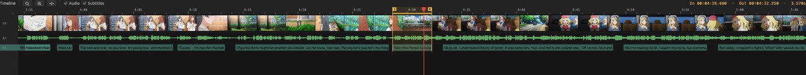
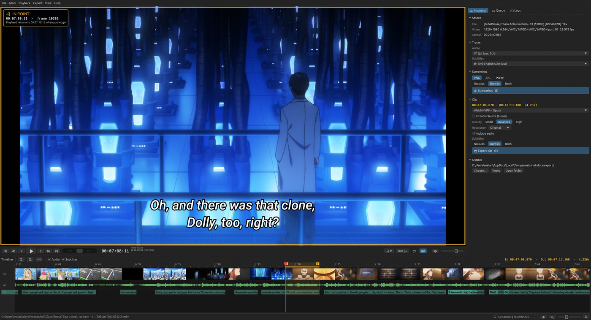

# Timeline & precise seeking

## Lanes

- **Ruler** — time labels. Zoomed in far enough, labels switch to frame numbers (`f10334`).
- **V1** — the video as a strip of thumbnails. Chapter markers (e.g. *Opening*, *Part A*) are drawn
  in purple with their names.
- **A1** — the waveform of the selected audio track: handy for finding where a line starts or a
  beat hits. It's read in the background after opening a file (and again when you switch audio
  tracks); turn it off with the *Audio* checkbox above the timeline.
- **S1** — one block per subtitle line of the selected subtitle track. Hover a block to read it.
  Signs and typesetting without readable text are left out. Lines can be edited, deleted and
  retimed — see *Editing subtitles* below.
  (Turn the lane off with the *Subtitles* checkbox above the timeline if you don't need it.)

The **red line** is the playhead. The **yellow** band and flags (`I` / `O`) are the clip range.

### Thumbnails and individual frames

Right after opening a file, Weebshot decodes one picture per keyframe for the whole episode in the
background (this takes a few seconds to half a minute). When you zoom in, the visible part is decoded
in more detail. While a part of the strip is still loading it's shown **dimmed with a spinner**
(using the nearest picture that's already there), and each real frame **fades in** when it arrives
— so you can always tell what's final.

Zoom in far enough and **every frame gets its own cell** with its frame number — handy for finding
the exact frame where a cut or a mouth movement happens. Anime holds most drawings for 2–3 frames,
so you'll often see the same picture several times in a row:

## Mouse

| Do this | To |
| --- | --- |
| Click | Jump to that frame |
| Drag | Scrub — the preview follows |
| Drag the In / Out line (anywhere along it, or its `I` / `O` flag) | Move the In / Out point. The preview shows the frame under the marker while you drag; the playhead goes back where it was when you let go. |
| Drag the yellow band in the ruler | Move the whole In→Out range |
| Click a subtitle block | Jump to the start of that line, and select it (outlined) |
| Double-click a subtitle block | Set In/Out to exactly that line |
| **Ctrl+click** a subtitle block | Play just that line, then stop |
| Drag a subtitle block's body | Retime the line, keeping its length |
| Drag a subtitle block's edge | Move just that line's start or end |
| **Ctrl + wheel** (or pinch) | Zoom around the pointer |
| Mouse wheel, Alt + drag, or middle-drag | Scroll left/right |
| Right-click | Set In/Out here, mark a line, zoom to In/Out, fit — or, over a subtitle block, edit its text or delete it |

While you drag a marker, the viewer shows the frame under it — framed in yellow, with a label
saying which marker it is (**IN POINT**, **OUT POINT** or **MOVING IN → OUT**) and its timecode
and frame number. This is only a preview: when you let go, the playhead jumps back to where it
was before you started dragging.

While dragging In, Out or the range, edges **snap** to subtitle line starts/ends and chapter
marks when they get close — hold **Shift** to place them freely. Hovering anywhere shows the time and
frame number; over a subtitle block it also shows the full line.

## Editing subtitles

Right-click a subtitle block for **Edit text…** or **Delete subtitle**. Clicking a block also
selects it (shown with an outline); [Delete](key:DeleteSubtitleLine) removes whichever line is
selected, so you don't have to right-click for it every time. Selection is independent of the
playhead, so it won't change out from under you if the video keeps playing.

To retime a line, drag its body to move it (the length stays the same) or drag an edge to change
just its start or end.

Editing a line's text keeps its font, color and position — only that one line loses its
per-character ASS overrides (mid-line bold/italic, etc.), since there's no way to tell where those
should land in new text. Lines you don't touch are untouched, byte-for-byte. The preview and any
export reflect your edits; *File → Export → Save subtitles as…* writes the current (edited) track
out as a standalone `.ass` file.

You can also zoom with the **slider at the bottom right of the status bar** (it keeps the playhead
in view), or the keyboard: [=](key:ZoomIn) in, [-](key:ZoomOut) out, [Shift+Z](key:ZoomFit) fit the
whole file.

## Frame-accurate positioning

Everything snaps to frames. Clicking or dragging on the timeline lands on the **start of the
frame** under the pointer. Scrubbing never queues up: Weebshot keeps at most one seek in flight and
always jumps to where the pointer is *now*. Zoomed out, the preview shows the nearest keyframe while
you drag (that's much faster) and the exact frame when you let go; zoomed in, every position is exact.

### Stepping

The arrow keys step, and holding **Shift** or **Ctrl** makes the step bigger:

| Keys | Default step |
| --- | --- |
| [←](key:FrameBack) / [→](key:FrameForward) | 1 frame |
| [Shift+←](key:SeekBackSmall) / [Shift+→](key:SeekForwardSmall) | 1 second |
| [Ctrl+←](key:SeekBackBig) / [Ctrl+→](key:SeekForwardBig) | 5 seconds |

The sizes (in frames or seconds) are set in *Options → Playback*, the keys in *Options → Shortcuts*.
Hold a key to repeat. Frame steps pause playback.

### More ways to move

- The **shuttle** next to the play button works like Premiere's: push the knob right to play
  forward faster, left to play backwards, and let go to stop. [L](key:ShuttleForward) /
  [J](key:ShuttleBack) do the same from the keyboard — press again to double the speed — and
  [K](key:ShuttleStop) stops. Backwards playback is done by seeking, so it's choppier than forwards.
- [↑](key:PrevSubtitle) / [↓](key:NextSubtitle) jump to the previous / next subtitle line — the fastest
  way to find a line of dialogue.
- [I](key:SetIn) / [O](key:SetOut) mark the frame currently shown.
- [X](key:MarkSubtitleLine) sets In and Out to the start and end of the subtitle line on screen.

### Typing a position

Click the timecode under the viewer and type any of:

| Input | Means |
| --- | --- |
| `83.5` | 83.5 seconds |
| `1:23.5` | 1 minute 23.5 seconds |
| `0:01:23.250` | hours:minutes:seconds |
| `00:01:23:12` | timecode with frames (frame 12 of second 83) |
| `#2000` or `f2000` | frame number 2000 |

Press Enter to go there, Esc to cancel.

### Looping

[P](key:ToggleLoop) (or the loop button) plays the In→Out range on repeat, so you can check a cut
before exporting. For a single pass instead of repeating forever, use
[Ctrl+Space](key:PlayFromIn) (play the whole range from In) or [Shift+Space](key:PlayToOut) (play
from wherever you are to Out) — handy for checking exactly where a loop export (see
[Clips](clips.md)) will seam.
